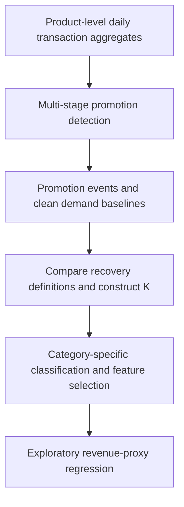
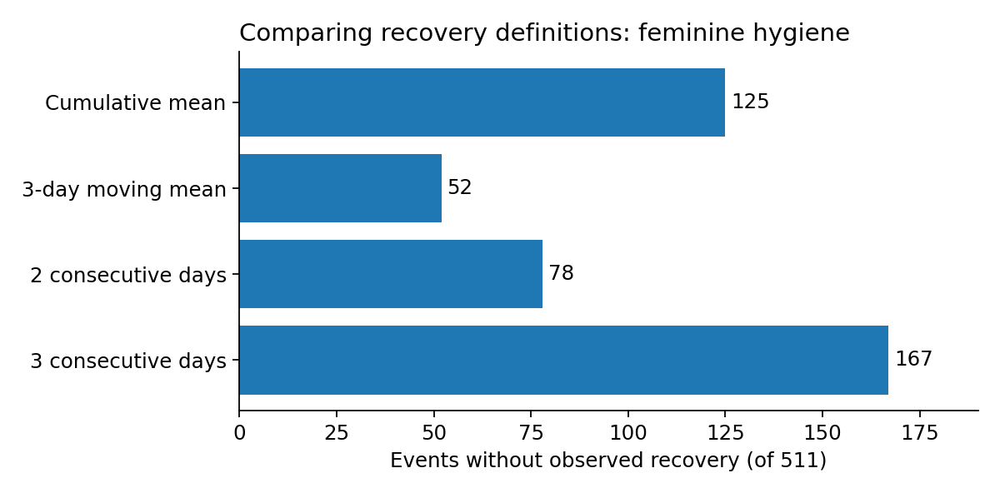
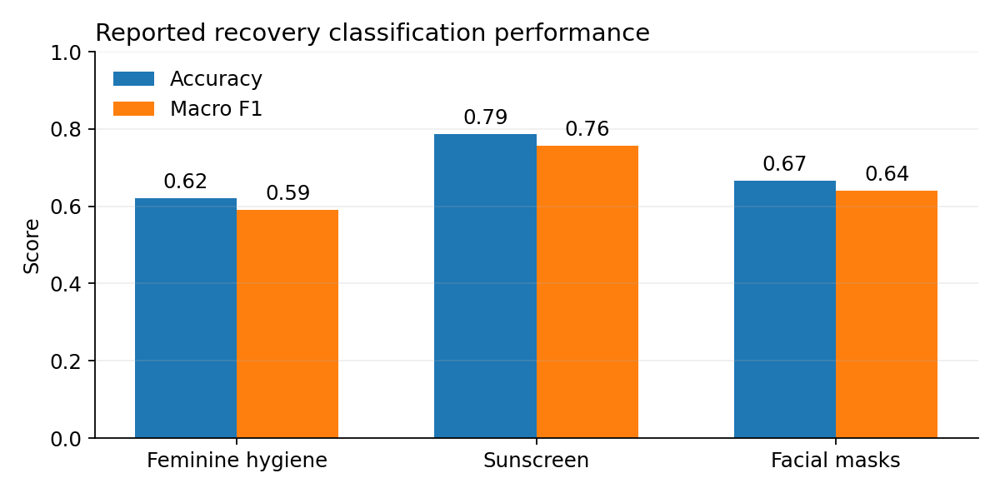
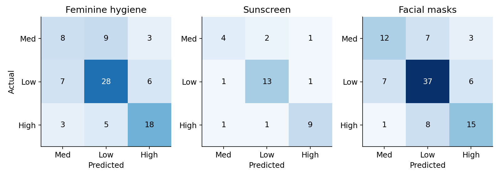

# Post-Promotion Demand Recovery Prediction

**Event detection · Target engineering · Applied machine learning · Retail decision analytics**

A six-person Big Data and Business Analytics course project at National Taiwan University.

## Overview

Promotions can accelerate purchases and alter demand after a campaign ends. We investigated how to identify promotional events from transaction histories, measure the time required for demand to return to its baseline, and predict recovery patterns across product categories. The goal was to support decisions about promotion frequency, discount intensity, and inventory preparation.

## My Contributions

- Co-developed a multi-stage promotion detection algorithm using rolling statistics, median absolute deviation (MAD), and demand-based event filtering.
- Co-developed the event-level demand recovery framework, comparing four definitions to establish a suitable prediction target.
- Co-implemented and evaluated category-specific classifiers, including Logistic Regression, SVM, KNN, Random Forest, and XGBoost.
- Collaborated on forward feature selection, model evaluation, and selection of category-specific predictive models.
- Co-developed a two-stage predictive framework connecting demand recovery classification with XGBoost-based revenue-proxy estimation.
- Participated in interpreting model results and developing recommendations for promotion frequency, discount intensity, and inventory planning.

The predictive modeling components were jointly developed by another team member and me. Other team members handled upstream data processing, product categorization, and historical feature engineering. Reported experimental results are team-level outcomes.

## Analytical Workflow

## Promotion Detection and Target Engineering

The detection algorithm uses a 14-day rolling window, MAD-based initialization, and iterative exclusion of previously flagged days. Demand-peak checks, short-gap merging and boundary trimming help identify contiguous promotion events rather than isolated discount spikes.

For each event, demand recovery time ($K$) is measured relative to a clean pre-promotion baseline. Four definitions were compared: cumulative average, three-day moving average, two consecutive days and three consecutive days above or at baseline. The two-consecutive-day definition was selected to balance robustness and sample retention. Follow-up is capped at 60 days and stops at the next promotion.

## Predictive Modeling and Findings

Three categories with larger event samples were selected for separate classification models. Category-specific recovery thresholds distinguish low, medium and high K. The team evaluated five classifiers and used sequential feature selection in the modeling process. The selected models use distance-weighted KNN with standardized features.

| Category | Promotion events | Mean observed K (days) | Accuracy | Macro F1 |
|---|---:|---:|---:|---:|
| Feminine hygiene | 511 | 8.61 | 0.6207 | 0.5917 |
| Sunscreen | 221 | 5.80 | 0.7879 | 0.7574 |
| Facial masks | 608 | 5.69 | 0.6667 | 0.6406 |

Observed recovery was slower on average for feminine hygiene products than for sunscreen and facial masks. Category-specific modeling accommodates differences in purchase patterns and demand dynamics. The team also explored a second-stage XGBoost regressor using predicted recovery classes to estimate a revenue proxy and inform promotion scenario analysis.

## Notebooks

| Notebook | Focus |
|---|---|
| [01 — Promotion event detection](notebooks/01_promotion_event_detection.ipynb) | Rolling statistics and event filtering |
| [02 — Recovery time definition](notebooks/02_recovery_time_definition.ipynb) | Clean baseline, four K definitions, event features |
| [03 — Feminine hygiene](notebooks/03_feminine_hygiene_model.ipynb) | Classifier comparison, forward selection, KNN, revenue proxy |
| [04 — Sunscreen](notebooks/04_sunscreen_model.ipynb) | Classifier comparison, selected KNN, revenue proxy |
| [05 — Facial masks](notebooks/05_facial_masks_model.ipynb) | Classifier comparison, forward selection, KNN, revenue proxy |

Core implementations are in [`src/`](src/). See [methodology](docs/methodology.md) and [feature engineering](docs/feature_engineering.md).

## Repository Scope and Reproducibility

This repository presents the course methods and reported aggregate results. Enterprise transaction records and event-level feature tables are not distributed. Classification scores describe the original evaluation split rather than an independent prospective test. See [methodology](docs/methodology.md) for evaluation design and interpretation.

Install dependencies in an isolated environment with `pip install -r requirements.txt`. Open the notebooks from the repository root or `notebooks/`. The first two notebooks include synthetic illustrations or recorded summary data; the category models require authorized local event tables as described in [data requirements](data/README.md).

Run supplementary synthetic unit tests with `python -m unittest discover -s tests`.
